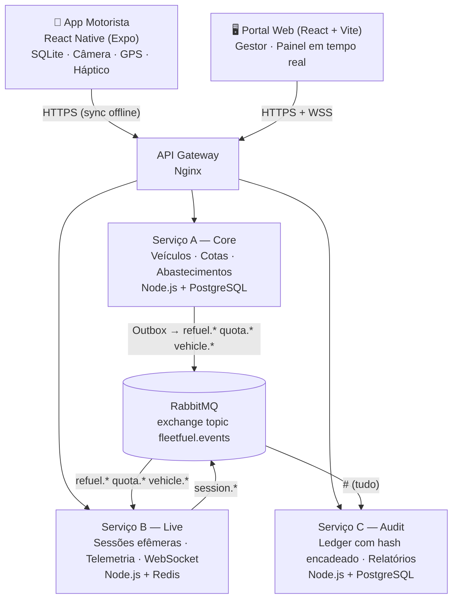
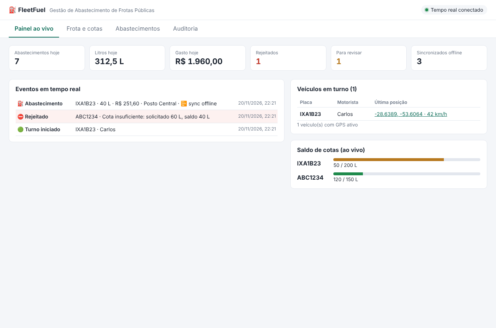
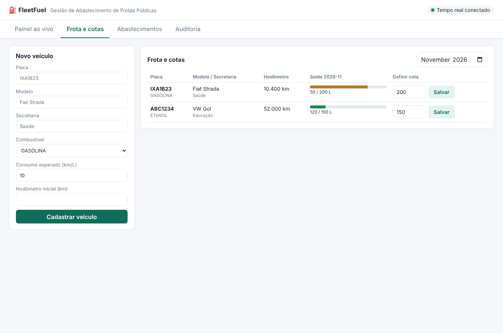
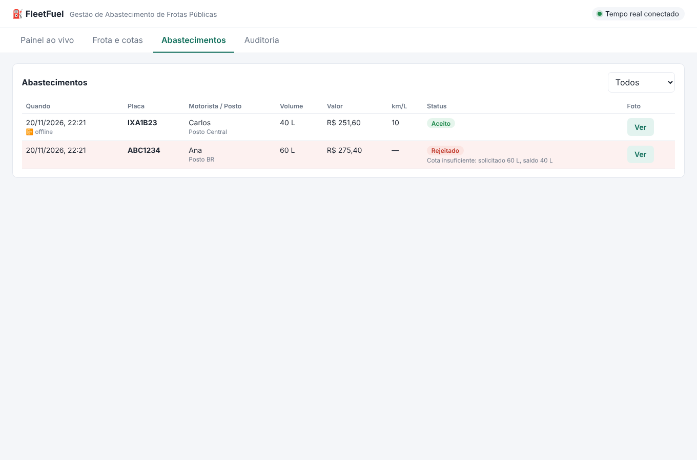
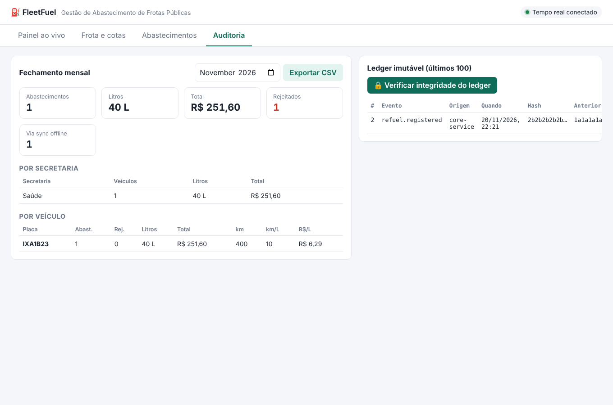

# ⛽ FleetFuel — Gestão de Abastecimento de Frotas Públicas

Trabalho final de **Arquitetura de Software / Sistemas Distribuídos e Web** (7º semestre, Ciência da Computação).
**Aluno:** João Vittor Cordeiro Nicolodi de Freitas

Ecossistema distribuído para controlar o abastecimento dos veículos de uma prefeitura:
cada veículo tem uma **cota mensal de litros**; o motorista registra o abastecimento no posto
pelo **app** (com **foto do hodômetro**, funcionando **sem sinal**) e a gestão acompanha tudo
**em tempo real** num painel web, com **histórico imutável** para auditoria.

| Requisito do domínio | Onde está resolvido |
|---|---|
| **Alta concorrência:** saldo da cota mensal por veículo | Serviço A: `SELECT … FOR UPDATE` + Unit of Work + `CHECK (used_ml <= limit_ml)` |
| **Mobile/Hardware:** validação do hodômetro por foto | App: `expo-camera` → foto obrigatória, armazenada no Serviço A e revisada no painel |
| **Mobile/Hardware:** lançamento offline em posto sem sinal | App: fila no `expo-sqlite` + `SyncEngine` idempotente (`clientId` = Idempotency-Key) |

---

## 1. Arquitetura



| Serviço | Responsabilidade | Banco (exclusivo) | Comunicação |
|---|---|---|---|
| **A · core-service** `:3001` | Regras mestras: veículos, cota mensal, abastecimento, hodômetro, foto | PostgreSQL `core` | HTTP (síncrono) + publica eventos via **Transactional Outbox** |
| **B · live-service** `:3002` | Turno do motorista (token efêmero c/ TTL), telemetria GPS, projeção ao vivo, **WebSocket** | Redis | HTTP + WS; consome eventos de A; publica `session.*` |
| **C · audit-service** `:3003` | Ledger **append-only** com hash SHA-256 encadeado, fechamento mensal, CSV | PostgreSQL `audit` | **100% por eventos** (nenhum POST); HTTP só leitura |

**Database-per-service:** são dois Postgres separados + um Redis; nenhum serviço lê o banco do outro.
O que um serviço precisa saber do outro chega por **evento** (ex.: o Serviço C monta seu próprio read model `refuel_facts`).

### Fluxo de um abastecimento offline
1. Motorista sem sinal preenche litros, hodômetro, preço e tira a **foto** → app gera `clientId` (UUID) e grava no **SQLite**.
2. Sinal volta → `NetInfo` dispara o `SyncEngine`, que envia em ordem cronológica com `Idempotency-Key: <clientId>`.
3. Serviço A abre transação → **trava o veículo e a cota** (`FOR UPDATE`) → confere se o `clientId` já existe → valida hodômetro e saldo → grava abastecimento **e** evento no `outbox` (mesma transação).
4. `OutboxRelay` publica no RabbitMQ (publisher confirms) → B atualiza o Redis e **empurra via WebSocket** para o painel; C **anexa ao ledger**.
5. Se a resposta se perder no caminho, o app reenvia: o servidor devolve `200 (replay)` sem debitar de novo.

### Painel web
| Painel ao vivo | Frota e cotas |
|---|---|
|  |  |
| **Abastecimentos** | **Auditoria** |
|  |  |

---

## 2. Como rodar

Pré-requisitos: Docker Desktop, Node.js 22 LTS e (para o app) o **Expo Go** no celular.

```bash
docker compose up --build        # sobe Postgres x2, Redis, RabbitMQ, 3 serviços, web e gateway
node scripts/seed.mjs            # cadastra 5 veículos com cota no mês atual
```

- Painel: **http://localhost:8080**
- RabbitMQ (filas, DLQs): http://localhost:15672 — `guest/guest`

### App mobile
```bash
cd mobile && npm install && npx expo start
```
Escaneie o QR Code com o Expo Go. Na aba **Turno**, informe o endereço do gateway com o **IP da sua máquina na rede**
(ex.: `http://192.168.0.10:8080` — `localhost` não funciona no celular), toque em *Atualizar veículos*, escolha o veículo.

> **Demonstrar o offline:** ative o modo avião → registre 2 abastecimentos (o app mostra “Salvo no aparelho” e o saldo estimado cai) → desative o modo avião → em segundos os itens viram “Sincronizado” e aparecem no painel em tempo real.

### Testes
```bash
npm run install:all
npm test                     # testes de domínio/casos de uso dos 3 serviços + SyncEngine do app
npm run check:core-purity    # falha se algum src/core importar biblioteca externa
node scripts/concurrency-attack.mjs   # com o compose rodando: prova que não há race condition
```

---

## 3. Clean Architecture

Os 3 serviços seguem a mesma estrutura:

```
src/
├── core/                     ← NÃO importa nenhuma biblioteca (verificado por script)
│   ├── domain/
│   │   ├── entities/         Vehicle, MonthlyQuota, Refuel | DriverSession | LedgerEntry
│   │   ├── value-objects/    Plate, Liters (mL inteiros), Odometer, Money (centavos), CompetenceMonth…
│   │   └── shared/           Result<S,E> e erros de domínio como VALORES
│   └── use-cases/
│       ├── ports/            interfaces: repositórios, UnitOfWork, Outbox, PhotoStorage, Broadcaster…
│       └── dtos/
├── infra/
│   ├── database/             postgres/ ou redis/ (concretos) + in-memory/ (testes)
│   ├── http/                 Fastify: controllers + mapeamento erro de domínio → status HTTP
│   ├── messaging/            RabbitMQ: outbox relay, publishers, consumers com DLQ
│   └── websockets/           (Serviço B) hub WebSocket + Redis Pub/Sub
└── main.ts                   Composition Root: único lugar que instancia as implementações
```

- **Independência de frameworks:** `scripts/check-core-purity.mjs` varre `src/core` e falha se encontrar qualquer `import` que não seja relativo ao próprio core.
- **Testabilidade:** todos os casos de uso são testados com repositórios **in-memory** (`node:test`, sem banco nem broker). Total: **51 testes**.
- **Erros funcionais:** o domínio retorna `Result<S, E>` (`ok()` / `fail()`); `throw` fica reservado para falha de infraestrutura. Ex.: `MonthlyQuota.debit()` → `Result<Liters, QuotaExceededError>`.

---

## 4. Decisões técnicas (resumo — detalhes em [`docs/ARGUICAO.md`](docs/ARGUICAO.md))

| Decisão | Por quê |
|---|---|
| Lock pessimista (`FOR UPDATE`) em vez de `SERIALIZABLE` | Sob disputa pela mesma cota, `SERIALIZABLE` aborta transações (erro 40001) e exige retry; o lock enfileira sem abortar. |
| Ordem de lock fixa: veículo → cota | Evita deadlock entre “abastecer” e “alterar cota”. |
| Idempotência checada **depois** do lock | Dois reenvios simultâneos do mesmo `clientId` não passam os dois pela checagem. |
| `CHECK (used_ml <= limit_ml)` no banco | Defesa em profundidade: mesmo um bug no código não deixa o saldo negativo. |
| Litros em mL e dinheiro em centavos (inteiros) | `0.1 + 0.2 !== 0.3` em ponto flutuante; saldo de cota não pode ter erro de arredondamento. |
| Transactional Outbox | Sem ele, o serviço poderia debitar a cota e cair antes de publicar o evento (ou o contrário). |
| Consumidores idempotentes por `eventId` | O outbox garante *at-least-once*; B usa `SET NX` no Redis, C usa `UNIQUE(event_id)`. |
| Ledger com hash encadeado + trigger anti-UPDATE/DELETE | Imutabilidade verificável: `GET /api/audit/ledger/verify` aponta a sequência adulterada. |
| WebSocket via Redis Pub/Sub | Permite escalar o Serviço B horizontalmente; todas as réplicas entregam a todos os painéis. |
| Sync offline em ordem e parando no 1º erro transitório | Hodômetro chega sempre crescente; não martela rede ruim (backoff exponencial com jitter). |

---

## 5. API (via gateway `:8080`)

| Método | Rota | Serviço | Descrição |
|---|---|---|---|
| POST | `/api/core/vehicles` | A | Cadastra veículo |
| GET | `/api/core/vehicles?month=YYYY-MM` | A | Frota com saldo da cota |
| PUT | `/api/core/vehicles/:id/quotas/:month` | A | Define/altera cota (`{limitLiters}`) |
| POST | `/api/core/refuels` | A | Registra abastecimento — `201` criado · `200` replay · `422` rejeitado · `400` inválido |
| GET | `/api/core/refuels?status=&vehicleId=` | A | Lista abastecimentos |
| GET | `/api/core/refuels/:id/photo` | A | Foto do hodômetro |
| POST | `/api/live/sessions` | B | Inicia turno → token efêmero (TTL 12 h) |
| DELETE | `/api/live/sessions/:token` | B | Encerra turno |
| POST | `/api/live/telemetry` | B | Posição GPS (`Authorization: Bearer <token>`, throttle 2 s) |
| GET | `/api/live/snapshot` | B | Estado atual do painel |
| WS | `/ws` | B | Snapshot + eventos em tempo real |
| GET | `/api/audit/ledger` | C | Histórico imutável |
| GET | `/api/audit/ledger/verify` | C | Verifica a cadeia de hashes |
| GET | `/api/audit/reports/monthly?month=&format=csv` | C | Fechamento mensal (JSON ou CSV) |

---

## 6. Limitações conhecidas / trabalhos futuros
- **Autenticação** de gestores (JWT/OIDC no gateway) não foi implementada: fora do escopo avaliado.
- A foto é validada por presença + regra de consumo (km/L fora de ±40% vira `FLAGGED` para o gestor conferir); **OCR** automático exigiria *development build* (ML Kit), incompatível com Expo Go.
- Dois celulares lançando offline para o **mesmo veículo** podem gerar rejeição por hodômetro fora de ordem; o registro fica `REJECTED` no ledger para o gestor tratar.
- Fotos em disco local (volume Docker); em produção, S3/MinIO atrás da mesma porta `PhotoStorage`.
